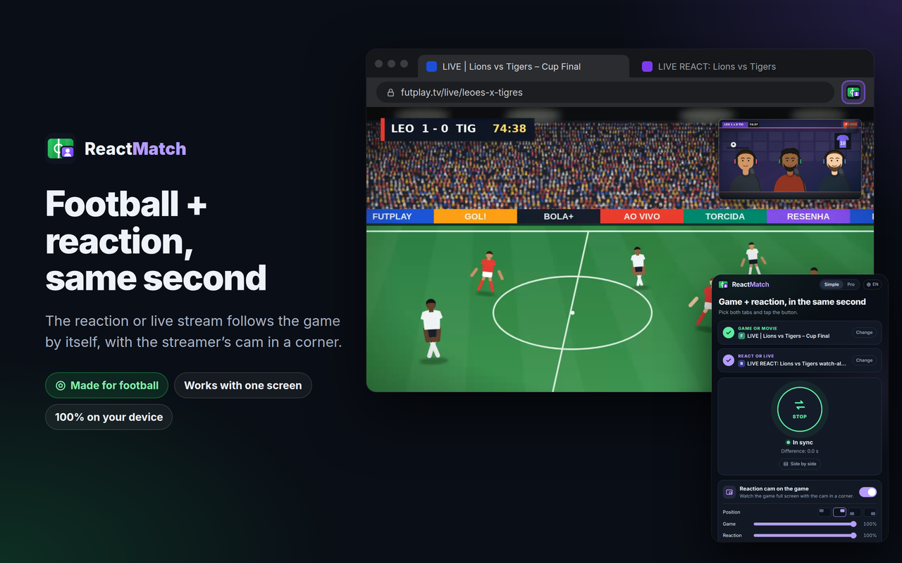

# ReactMatch

A Chrome extension that **keeps a reaction or a live in sync with the football game (or movie, or series) you are watching**, with the streamer's cam in a corner of the game, even when each of you watches through a different service.



You open the game in one tab and the creator's live in another. The creator shows the match clock on screen; your game also shows it. ReactMatch finds both clocks, reads them and moves your game (or pauses it) so both show the same minute. It keeps checking while you watch.

It doesn't matter if the creator watches on one service and you on another: what lines the videos up is **the moment in the content** (the match clock), not the position of each player. And because the clock is read from inside the creator's video, it arrives together with the reaction you hear.

## Features

- **Finds the clocks:** looks at a few frames of each video and keeps only the numbers that tick with the video. A score, a static "Replay 12:30" or a stream uptime in h:mm:ss are ignored. If there's more than one clock, you pick it with one click; you can always draw the box by hand.
- **Reads the players directly:** frames come straight from the `<video>` element, so there's no screen-sharing dialog. Players embedded from another site (iframes) work too, after you allow that site. DRM-protected players fall back to a tab capture.
- **Precise, and calm about it:** each frame carries the player position it was taken at, and several readings are averaged (the clocks only show whole seconds). A blurry frame is skipped; when the clocks change for good (halftime, a reset), it syncs again from the new ones.
- **Either side can be adjusted:** the video that is ahead goes back. If its player can't rewind (a live), it pauses for exactly the difference and resumes; if it even jumps back to live when resumed, the other video skips ahead instead.
- **Simple and Pro:** Simple is two taps on your tabs and one big Sync button; Pro adds the players, the clocks, fine adjustment, manual calibration and the demo.
- **One screen is enough:** leave the reaction in a background tab. When syncing, ReactMatch shows that tab for a moment to read its clock, then puts everything back; after that the videos' own timelines keep them together.
- **One click:** "Sync" finds the clocks and uses the frames it looked at as the first estimate, so syncing starts in seconds.
- **Side by side (optional):** gives each video its own window and docks the panel on the right, so both clocks stay readable all the time.
- **Same moment,** for videos without a clock: pause both on the same scene and mark it.
- **Fine adjustment** in half-second steps, and a **demo** with simulated clocks.
- **The creator's cam on the game:** pick the cam's area in the reaction and it appears over the game, in the corner you choose or wherever you drag it, also in fullscreen. Each video has its own volume.
- English, Português and Español; follows Chrome's language, with a menu to change it.
- **Private:** no account, no server, no analytics. Frames are read in memory on your computer and discarded. [Privacy policy](https://joaoestella.github.io/ReactMatch/).

## Install (developer mode)

1. Download or clone this repository.
2. Open `chrome://extensions` and turn on **Developer mode** (top right).
3. Click **Load unpacked** and select the **`extension`** folder.
4. Pin the icon and click it: the ReactMatch panel opens in its own window.

Chrome 116+ (and Chromium browsers such as Edge, Brave and Opera).

## How to use

1. Open the game and the reaction (or live) in Chrome and press play on both.
2. Click the ReactMatch icon. The panel opens as a narrow window on the right.
3. Under **1 · Game or movie**, tap the game's tab; under **2 · React or live**, tap the reaction's tab. Chrome asks for access to each site the first time.
4. Tap the big **Sync** button. It finds both clocks and starts syncing, usually in a few seconds.

The order doesn't matter: whichever video is ahead goes back (or, if its player can't rewind, pauses for the difference). If the reaction still feels a little early or late, use the fine adjustment.

**Reaction in the background (one screen).** Chrome can stop drawing videos in background tabs. When you sync, ReactMatch briefly shows an uncaptured tab to read its clock and then restores the tab you were watching. This also works with manually selected clocks and when syncing again; confirming selected regions takes several seconds per video. While only the players' timelines are available, the panel says **Estimated sync**, because the clocks are not being re-read. Tap **Sync again** if the creator pauses or rewinds their game. To keep reading in the background, click the ReactMatch icon once on **each video's tab** (or press **Alt+Shift+S** there). Turning on the cam keeps the reaction captured too; **Side by side** is another option.

**Small clocks.** Detection keeps small text regions and enlarges them before reading. Uncertain readings get a contrast-enhanced retry, and synchronization requires consistent clock readings. If the clock is still unreadable, select just its digits in Pro mode or increase the video's playback quality; enlarging a blurred image cannot restore missing detail.

**0.4.1 clock-reading fixes.** Clock digits and colons returned as separate nearby OCR words are joined before detection. Calibration uses at least three reliable readings, so one blurred frame no longer discards the other four. A failed calibration identifies the video and displays the recognized text. After updating, reload the extension and both video tabs; the panel should show **v0.4.1**.

### The creator's cam over the game

**Reaction cam on the game** puts the creator's cam in a corner of the game, so you can watch the game full size and still see the reaction:

1. Turn the switch on and draw a box around the creator's camera in video 2 (or use the whole picture).
2. The first time, Chrome asks for one click: go to the reaction's tab and click the ReactMatch icon (or press **Alt+Shift+S**). The cam then appears by itself.
3. Pick a corner, or drag the cam anywhere; it follows the game into fullscreen.
4. Set the **Game** and **Reaction** volumes. While the cam is shown, the reaction's sound comes through the game's tab.
5. While watching, the **⋯** button on the cam opens its menu: sync again, both volumes, the corner and the size, and removing the cam. No need to go back to the panel.

The reaction's tab can then go to the background: being captured, Chrome keeps drawing it, so syncing carries on.

For content without a clock, switch to **Pro** and open **No clock on screen, or the wrong one?**: pause both on the same scene and click **Mark same moment**, or type what each clock shows.

## Limits

- The panel window must stay open.
- One timeline per sync: halftime, replays, ads or a new episode need a new reference.
- Clocks are read as `mm:ss` or `h:mm:ss`. Stoppage time shown as `45:00 +2` is not understood yet.
- Players that block reading their image need the tab capture fallback, which Chrome asks you to confirm.
- TVs and apps outside the browser are not supported.

## Development

The extension is plain JavaScript (no build step) in `extension/`:

| File | What it does |
| --- | --- |
| `panel.js` | The session: connecting tabs, finding and reading clocks, keeping both videos in sync, arranging windows |
| `media-bridge.js` | Injected in each frame of a connected tab: lists, controls and grabs frames from `<video>` |
| `browser-adapter.js` | Talks to the bridge through `chrome.scripting` |
| `core.js` | Pure logic: clock parsing, tracking, offset estimation, what to correct and how |
| `finder.js` | Locates lines of text on a frame so OCR only reads small crops |
| `pip.js` | Injected in the game's tab: draws the captured cam over the game and plays the reaction's sound at its own volume |
| `ocr.js` | Local Tesseract.js worker, frame crops, the box editor and the tab-capture fallback |
| `i18n.js`, `locales/` | Interface languages |

```sh
npm test               # unit tests (Node 20+)
npm install            # Playwright and Tesseract.js, for the tools below
npm run test:browser   # loads the extension in Chromium; needs ffmpeg with drawtext on PATH
npm run bundle:ocr     # rebuilds extension/vendor from node_modules
npm run preview        # serves the panel at http://127.0.0.1:4188 (demo only)
```

The browser tests build two videos with clocks burned in, then sync a creator live with a game embedded from another site, a live game with a 3-second rewind window, and a live player that jumps to live when resumed.

OCR: [Tesseract.js](https://github.com/naptha/tesseract.js) 7 with the `eng` model, bundled in `extension/vendor/` with their licenses. Nothing is downloaded at runtime.

See [ROADMAP.md](ROADMAP.md) for what's next.
